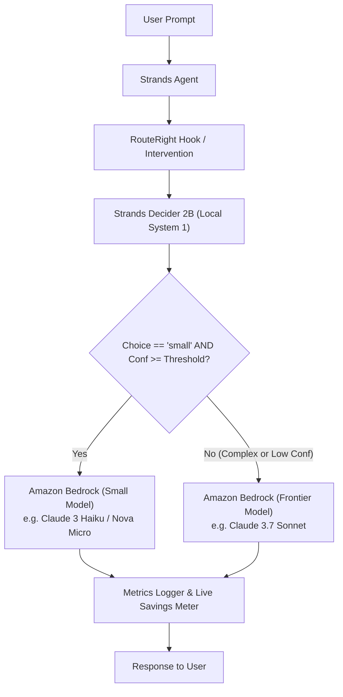

# RouteRight Architecture

RouteRight decouples decision logic from generation by placing Strands Decider 2B directly in the execution path of Strands agents before any Amazon Bedrock call.

## System Components

## Core Modules

1. **`routeright.pattern`**:
   - `spec.py`: Defines the typed question (`model_routing_tier`, options `["small", "frontier"]`).
   - `wiring.py`: Exposes `DeciderRoutingStrategy` (implements Strands `RoutingStrategy`), `RouteRightPattern`, and `create_decider_router`.
   - `example.py`: Real executable Strands `Agent(model=router)` example.
   - `PATTERN.md`: Pattern specification, wiring guide, threshold tuning, and production limits.

2. **`routeright.decider`**:
   - `StrandsDeciderClient`: HTTP client (`POST /v1/systemone`) and in-process fallback using `strands_decider.infer.SystemOneEngine`.
   - Timing: `time.perf_counter()` wrapping raw HTTP/inference with no-cache headers.

3. **`routeright.router`**:
   - `RouteRightRouter`: Implements the core escalation rule.
   - `Pricing`: Loads real token pricing from `config/pricing.json`.
   - `Metrics`: Logs structured JSON decisions (question, choice, confidence, decision latency, model, tokens, cost).

4. **`routeright.server` & `routeright.static`**:
   - FastAPI backend with SSE streaming endpoint (`/api/benchmark/stream`).
   - Dark editorial dashboard with live routing inspection, real-time savings meter, and benchmark comparisons.
   - Guarded simulation banner if `ROUTERIGHT_MOCK_MODE=true` is set.

5. **`scripts/benchmark.py`**:
   - Evaluation runner testing 50 benchmark queries across 3 modes: `routeright`, `always-frontier`, and `always-small`.
   - Measures decision latency, end-to-end latency, real Bedrock token cost, and agreement against reference labels.
   - Generates `results/results.json` and `results/summary.md`.

## Latency and Cost Efficiency

- **Decider 2B Decision Overhead**: Micro-decision latency measured with `time.perf_counter()` (results logged in `results/results.json`).
- **Cost Differential**: Small models cost significantly less per token than frontier models based on official AWS pricing.
- **Fail-Safe Guarantee**: If Decider 2B is unreachable or confidence is below threshold, RouteRight unconditionally routes to frontier. Hard questions escalate to the frontier model.
