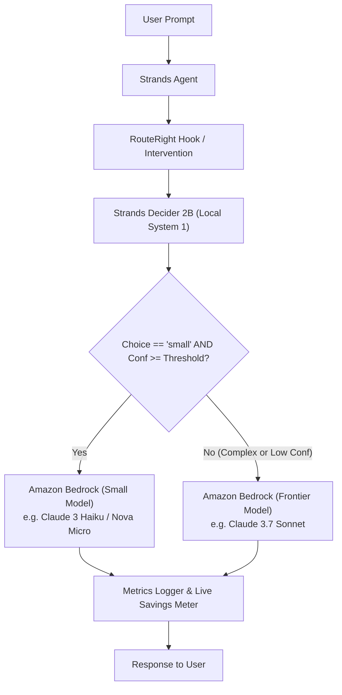

# RouteRight Architecture

RouteRight decouples decision logic from generation by placing Strands Decider 2B directly in the execution path of Strands agents before any Amazon Bedrock call.

## System Components

## Core Modules

1. **`routeright.pattern`**:
   - `spec.py`: Defines the typed question (`model_routing_tier`, options `["small", "frontier"]`).
   - `wiring.py`: Exposes `RouteRightPattern` and `RouteRightInterventionHandler` for Strands integration.
   - `example.py`: 20-line copy-paste code snippet for agent developers.

2. **`routeright.decider`**:
   - `StrandsDeciderModel` (in-process) and HTTP client (`POST /v1/systemone`).
   - `MockDeciderClient` for deterministic testing with calibrated confidence distributions and zero AWS cost.

3. **`routeright.router`**:
   - `RouteRightRouter`: Implements the core escalation rule.
   - `Pricing`: Loads real token pricing from `config/pricing.json`.
   - `Metrics`: Logs structured JSON decisions (question, choice, confidence, decision latency, model, tokens, cost).

4. **`routeright.server` & `routeright.static`**:
   - FastAPI backend with SSE streaming endpoint (`/api/benchmark/stream`).
   - Dark-theme web dashboard with live chat, real-time savings meter, and benchmark comparisons.

5. **`scripts/benchmark.py`**:
   - Evaluation runner testing 50 benchmark queries across 3 modes: `routeright`, `always-frontier`, and `always-small`.
   - Generates `results/results.json` and `results/summary.md`.

## Latency and Cost Efficiency

- **Decider 2B Decision Overhead**: 3-6 ms.
- **Small Model Latency**: 200-500 ms (vs 1200-2500 ms on frontier).
- **Cost Differential**: Small models cost 10x-20x less per token than frontier models.
- **Fail-Safe Guarantee**: If Decider 2B is unreachable or confidence is below threshold, RouteRight unconditionally routes to frontier.
