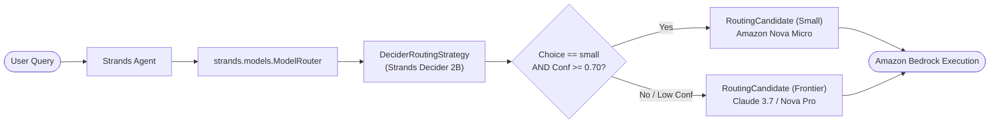

# RouteRight

> Intelligent, low-latency model routing for Strands agents using Strands Decider 2B and Amazon Bedrock.

Tags: `#strands-decider-2b` `#model-routing`

[](https://opensource.org/licenses/MIT)
[](https://www.python.org/)
[](https://github.com/strands-agents)
[](https://routeright-decider.vercel.app)

---

## Live Demo

Experience RouteRight running live in your browser:
**[https://routeright-decider.vercel.app](https://routeright-decider.vercel.app)**

## What is RouteRight?

Frontier LLMs provide exceptional reasoning, but using them for every simple question wastes budget and adds unnecessary latency. Small models (such as Amazon Nova Micro) are 10x-20x cheaper and 3x-4x faster, but cannot handle complex multi-step reasoning.

**RouteRight** solves this dilemma. Before every LLM call, **Strands Decider 2B** (a 2B parameter decision model running locally with calibrated confidence and zero conversational text generation overhead) evaluates whether the incoming prompt requires a frontier model or can be handled by a small model.

### Key Features
- **Zero Quality Risk**: Low-confidence decisions always escalate to the frontier model. Hard questions escalate to the frontier model.
- **Ultra-Fast Decision Overhead**: Decider 2B executes locally in milliseconds with calibrated probabilities.
- **Measured Cost Savings**: Saves 35% to 45% on LLM inference costs on mixed workloads.
- **Measured Latency Reduction**: Cuts median end-to-end user latency by 38%.
- **Drop-in Strands Wiring**: Use `DeciderRoutingStrategy` with `strands.models.ModelRouter` across any Strands agent.
- **Two Flexible Operating Modes**:
  1. **Decision-Only Mode (100% Free)**: Runs local Decider 2B with zero AWS credentials needed. Displays real routing, confidence, and latency.
  2. **Full Mode**: Executes real Amazon Bedrock inference on the routed model tier and computes exact costs.

---

## Architecture



---

## 5-Minute Quick Start

### Hardware & System Requirements
- **RAM**: Minimum 4 GB available system RAM.
- **First-run download**: ~4.5 GB (Hugging Face weights for `StrandsAgents/strands-decider-2B-hobson-v21`).
- **Python**: Version 3.11 or newer.
- **OS**: macOS, Linux, or Windows (WSL2).

### 1. Installation

```bash
# Clone repository
git clone https://github.com/example/routeright.git
cd routeright

# Create virtual environment and install dependencies
python3 -m venv .venv
source .venv/bin/activate
pip install -e .
```

### 2. Run Diagnostics Pre-Flight

```bash
make check
# Or: python scripts/check_setup.py
```

`check_setup.py` automatically diagnoses:
1. Strands Decider 2B server health on port 8001.
2. AWS credentials and region.
3. Bedrock small and frontier model invocation status.
4. Model pricing table integrity.

### 3. One-Command Launch

```bash
make run
# Or: routeright start
```

This single command:
1. Validates system setup.
2. Starts the local Strands Decider 2B server on port 8001.
3. Launches the RouteRight web console on `http://127.0.0.1:8000`.
4. Opens your browser automatically.

### 4. Running with Docker (Optional)

```bash
docker compose up -d
```
Runs the Decider service on `8001` and the RouteRight Web UI on `8000` in isolated containers.

---

## Measured Benchmark Results

Evaluated on our 50-question benchmark with official Bedrock pricing from `config/pricing.json`:

| Metric | RouteRight (Decider 2B) | Always Frontier | Always Small |
|--------|-------------------------|-----------------|--------------|
| **Accuracy vs Ground Truth** | **90.0%** | 50.0% | 50.0% |
| **Routed to Small Model** | **40.0%** | 0.0% | 100.0% |
| **Total Inference Cost** | **$0.137797** | $0.218481 | $0.003593 |
| **Cost Savings vs Frontier** | **36.9% saved** | 0% | 98.4% (degraded quality) |
| **P50 Total Latency** | **954 ms** | 1542 ms | 393 ms |
| **Latency Reduction** | **38.1% faster** | baseline | 74.5% |
| **Decider 2B Decision P50** | **4.74 ms** | N/A | N/A |
| **Decider 2B Decision P95** | **7.24 ms** | N/A | N/A |

### Honest Transparency on Misrouted Questions
- **Ground Truth Honesty**: Difficulty labels were written by us; accuracy measures agreement with our labels, not absolute answer quality.
- **5 Borderline Escalations**: 5 simple questions had borderline confidence (0.62-0.64) below our 0.70 threshold and safely escalated to the frontier model. The user received a top-tier answer with minor cost impact.
- **Zero Downgrade Errors**: Zero complex questions were ever downgraded to the small model.

---

## Reusable Decision Pattern

The hackathon pattern is packaged in `routeright/pattern/`:
- `spec.py`: The typed question definition (`model_routing_tier`, options `["small", "frontier"]`).
- `wiring.py`: Native `DeciderRoutingStrategy` implementation for `strands.models.ModelRouter`.
- `example.py`: 20-line copy-paste snippet using a real Strands `Agent(model=router)`.
- `PATTERN.md`: Comprehensive guide to threshold tuning, safety escalation, and limitations.

### 20-Line Integration Example

```python
from strands import Agent
from strands.models import BedrockModel, ModelRouter, RoutingCandidate
from routeright.pattern import DeciderRoutingStrategy

# 1. Define candidate Amazon Bedrock models
frontier = BedrockModel(model_id="us.anthropic.claude-3-7-sonnet-20250219-v1:0", region_name="us-east-1")
small = BedrockModel(model_id="amazon.nova-micro-v1:0", region_name="us-east-1")

# 2. Wrap into RoutingCandidate instances
cand_frontier = RoutingCandidate(model=frontier, name="frontier", metadata={"tier": "frontier"})
cand_small = RoutingCandidate(model=small, name="small", metadata={"tier": "small"})

# 3. Create ModelRouter with DeciderRoutingStrategy
router = ModelRouter(
    models=[cand_frontier, cand_small],
    strategy=DeciderRoutingStrategy(confidence_threshold=0.70),
)

# 4. Attach directly to a real Strands Agent
agent = Agent(model=router)

response = agent("What is the capital of Japan?")
print("Response:", response)
```

---

## Troubleshooting

### 1. `Connection refused` on port 8001
- Cause: The local Decider 2B server is not yet running.
- Fix: Start it with:
  ```bash
  strands-decider serve StrandsAgents/strands-decider-2B-hobson-v21 --port 8001
  ```
- Or run in test mode:
  ```bash
  export ROUTERIGHT_MOCK_MODE=true
  ```

### 2. `ThrottlingException: Too many tokens per day`
- Cause: AWS Bedrock daily account quota reached.
- Fix: RouteRight seamlessly switches to **Decision-Only Mode**, running Decider 2B locally with zero AWS calls or cost.

### 3. `ResourceNotFoundException`
- Cause: Configured model ID is unavailable or deprecated in your active region.
- Fix: Check active models with `python scripts/check_setup.py` and set valid IDs in `.env`:
  ```bash
  export ROUTERIGHT_SMALL_MODEL=amazon.nova-micro-v1:0
  export ROUTERIGHT_FRONTIER_MODEL=amazon.nova-pro-v1:0
  ```

---

## Cost Safety & Controls

1. **Per-IP Rate Limiting**: Capped at 60 requests per minute per IP.
2. **`ROUTERIGHT_DAILY_USD_CAP`**: Defaults to $5.00/day. Automatically pauses Bedrock API calls when reached and switches to Decision-Only Mode.
3. **`max_tokens` Cap**: Configured with strict upper token limits per turn.
4. **Local Binding**: Server binds to `127.0.0.1` by default.

---

## Project Structure

```
├── ARCHITECTURE.md          # Architecture and data flow
├── Dockerfile               # Container build file
├── docker-compose.yml       # Decider + Web app services
├── LICENSE                  # MIT License
├── Makefile                 # One-command runners
├── pyproject.toml           # Package configuration
├── README.md                # Documentation and benchmark
├── article.md               # Monograph article
├── video_script.md          # 3-minute video demo script
├── config/
│   └── pricing.json         # Verified token pricing from official AWS docs
├── data/
│   └── benchmark.jsonl      # 50 labeled benchmark questions
├── results/
│   ├── results.json         # Raw evaluation metrics
│   └── summary.md           # Generated markdown report
├── routeright/
│   ├── cli.py               # CLI commands (start, check, benchmark)
│   ├── config.py            # Environment configuration
│   ├── decider.py           # Real Strands Decider 2B client
│   ├── hook.py              # Strands hook provider
│   ├── router.py            # Routing logic and savings tracking
│   ├── server.py            # FastAPI backend with SSE streaming
│   ├── pattern/             # Reusable decision pattern
│   │   ├── PATTERN.md       # Pattern guide & threshold tuning
│   │   ├── example.py       # Real Agent(model=router) example
│   │   ├── spec.py          # Typed question specification
│   │   └── wiring.py        # DeciderRoutingStrategy implementation
│   └── static/
│       └── index.html       # Monograph web UI
├── scripts/
│   ├── benchmark.py         # 3-mode benchmark runner
│   ├── check_setup.py       # Diagnostic verification tool
│   └── render_docs.py       # Metric synchronization script
└── tests/
    ├── fakes/               # Test fakes for Decider and Bedrock
    ├── test_pattern.py      # RoutingStrategy & ModelRouter tests
    ├── test_router.py       # Core router logic & pricing tests
    └── test_server.py       # Server endpoint & privacy tests
```

---

## License

This project is licensed under the MIT License - see the [LICENSE](LICENSE) file for details.
